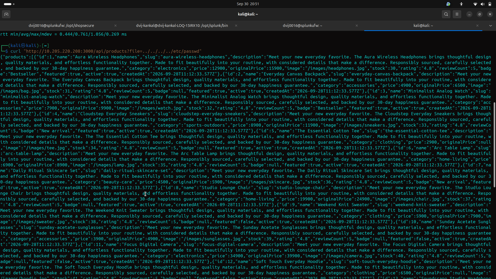
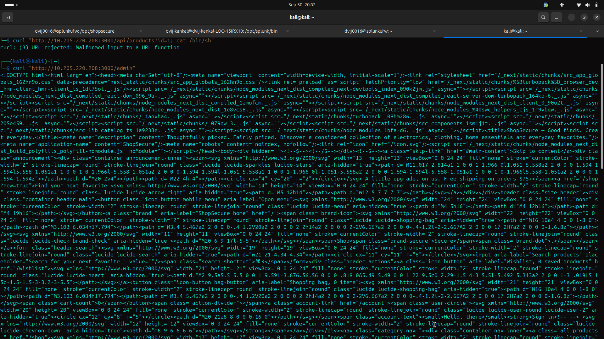
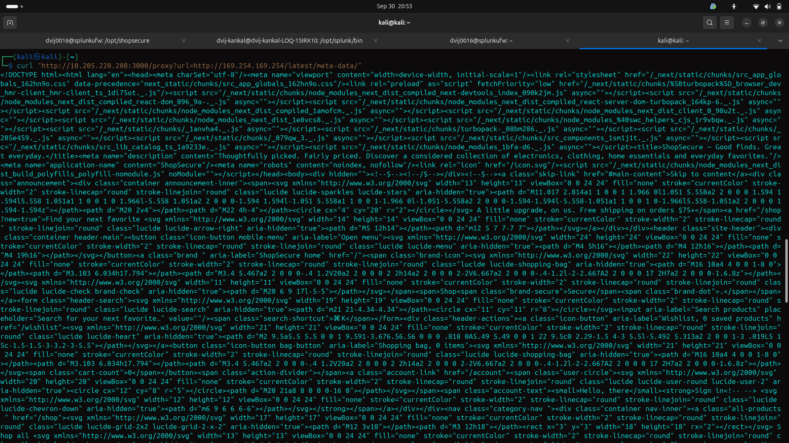
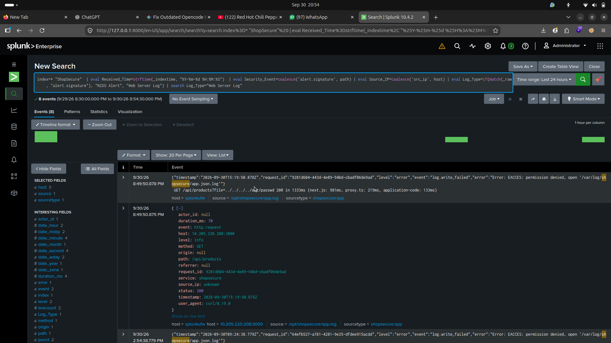
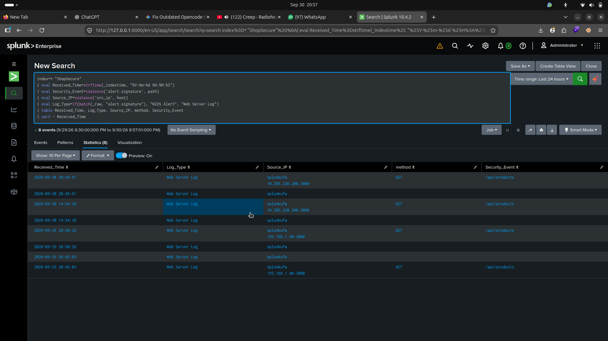

# SOC-SIEM OWASP Top 10 Lab

## Project Overview

This repository represents a custom SOC-SIEM environment designed for hands-on cybersecurity training and vulnerability detection. The setup utilizes **Kali Linux** as the attacker machine, a **virtualized Ubuntu Server** (hosted via VMware) acting as the target, **Suricata NIDS** for network intrusion detection, and **Splunk Enterprise** (running on the host machine) to detect and correlate OWASP Top 10 vulnerabilities in real-time. This pipeline demonstrates a complete red-to-blue team workflow, from exploit delivery to security monitoring and analysis.

## Architecture & Tech Stack

- **Kali Linux**: Attacker machine for red team operations
- **Ubuntu Server (VMware)**: Target host running the vulnerable web application, Suricata NIDS, and Splunk Universal Forwarder
- **Suricata NIDS**: Network intrusion detection with custom signatures for OWASP Top 10
- **Splunk Enterprise**: Host machine receiving logs over port 9997 for correlation and dashboarding
- **Splunk Universal Forwarder**: Deployed on the Ubuntu VM to forward logs to Splunk

### Network Topology

- Splunk Enterprise runs on the host machine, receiving logs over **port 9997** from a VMware Ubuntu VM
- The Ubuntu VM concurrently hosts the vulnerable Next.js web application, Suricata NIDS, and the Splunk Universal Forwarder
- Traffic flows from the attacker (Kali) through the network to the target VM, where Suricata inspects packets and the forwarder ships logs to Splunk

## Custom NIDS Ruleset

Custom Suricata signatures written for the following OWASP Top 10 categories:

- **A01: Broken Access Control** - Directory traversal and admin panel forceful browsing detection
- **A03: Injection** - SQL injection, XSS, and OS command injection patterns
- **A05: Security Misconfiguration** - Exposed environment file access attempts
- **A07: Identification and Authentication Failures** - Credential stuffing and default admin login detection
- **A10: Server-Side Request Forgery (SSRF)** - AWS Cloud metadata query detection

## Attack Execution (Red Team)

### Path Traversal

```

```

Demonstrates the `../../../etc/passwd` attack vector attempting to access system files via web request.

### Command Injection & Access Control

```

```

Shows the `/bin/sh` command injection and forceful browsing to the `/admin` endpoint.

### Server-Side Request Forgery (SSRF)

```

```

Illustrates the AWS metadata SSRF payload querying the 169.254.169.254 endpoint.

## SIEM Correlation (Blue Team)

Splunk uses SPL (Search Processing Language) to extract JSON fields and correlate network alerts with application web logs. The pipeline enables real-time monitoring and analysis of security events.

### Raw Logs

```

```

Displays the raw JSON event logs ingested from Suricata and the web application into Splunk.

### SOC Dashboard

```

```

The final SIEM correlation Statistics table showing aligned network alerts and web application events, providing operational visibility into detected threats and their context.